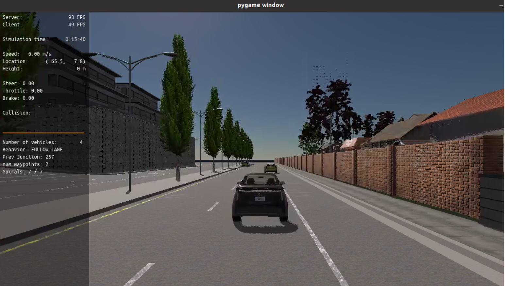
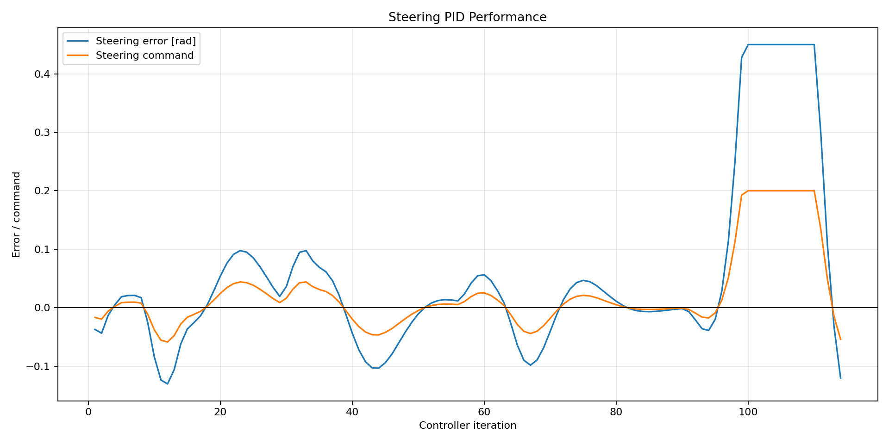
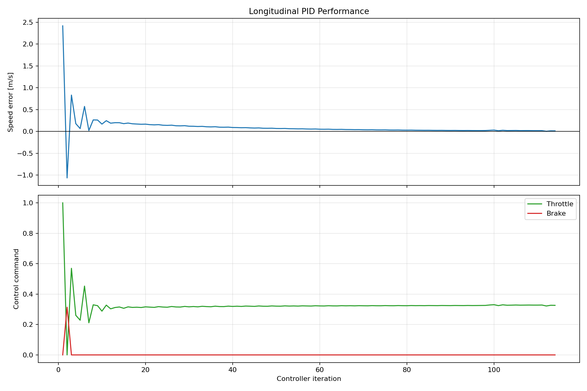

# PID Controller Report

## 1. Controller Setup

This project uses PID control to follow a planned trajectory in CARLA. One controller produces the steering command, while another produces throttle or brake.

| Controller | $K_p$ | $K_i$ | $K_d$ | Output limit |
|---|---:|---:|---:|---:|
| Steering | 0.45 | 0.00 | 0.00 | $[-0.20, 0.20]$ |
| Throttle/brake | 0.40 | 0.02 | 0.02 | $[-1.00, 1.00]$ |

The PID control law is

$$
u(t)=K_p e(t)+K_i\int e(t)\,dt+K_d\frac{de(t)}{dt}.
$$

For steering, the error is the angle between the vehicle and a target point on the trajectory. For longitudinal control, the error is the difference between target and measured speed. A positive longitudinal output is throttle, and a negative output is brake.

### Additional File Changes

Besides the three required PID files, I made two small supporting changes:

- In `simulatorAPI.py`, the virtual trajectory is advanced using the actual elapsed simulation time, capped at 0.05 s, instead of assuming 0.05 s for every rendered frame. The simulator also sends the real CARLA vehicle yaw together with its real position. These changes prevent the reference trajectory from moving at a different rate from the physical vehicle and avoid combining a real position with an unrelated virtual orientation. Without them, the steering error could remain incorrect even when the PID calculation itself was correct.
- In `planning_params.h`, I reduced the speed limit from 3.0 m/s to 2.5 m/s. The lower speed gives the vehicle more time to follow the avoidance trajectory and keeps the required steering corrections within the configured output limit. This improved stability and safety when passing the parked vehicles.

## 2. Simulation Results

### Step 1: Simulation Environment

This screenshot shows the CARLA test environment used for the project. It contains the ego vehicle and the three parked vehicles that must be passed. The planned path and candidate spirals are also displayed, and the collision indicator is empty.

### Steering

The blue curve is the steering-angle error and the orange curve is the steering command. They have the same shape because steering uses only the proportional term. Most corrections are small and smooth. Around iterations 99–110, the error becomes large during a strong turn and the command reaches its limit of 0.20. It then returns toward zero. This shows that the controller reacts to the path while keeping the steering command bounded.

### Throttle and Brake

The upper plot shows speed error. The lower plot shows throttle in green and brake in red. At startup, the large positive speed error produces full throttle. A short overshoot causes one brake pulse. The error then approaches zero and the throttle settles near 0.32. The response is stable because the error is small after the initial transient and there is no repeated switching between throttle and brake.

## 3. Effect of Each PID Term

- **Proportional ($P$):** reacts to the current error. A larger $K_p$ gives a faster and stronger response, but too much causes overshoot or oscillation. The steering plot shows the command following the error through the proportional gain.
- **Integral ($I$):** accumulates past error and removes steady-state error. In the speed controller it supplies the continuous throttle needed to maintain target speed. Too much integral action can cause overshoot and windup.
- **Derivative ($D$):** reacts to how quickly the error changes. It adds damping and reduces overshoot, but it is sensitive to noise. A small derivative gain is used for speed control to smooth the initial transient.

The steering controller uses only $P$. Integral action was unnecessary and could accumulate error during path changes. Derivative action was omitted because changes in the selected trajectory point can make the steering error noisy.

## 4. Automatic PID Tuning

I would run repeated simulations from the same initial conditions and minimize a cost function such as

$$
J=\sum e_{\text{steer}}^2+\sum e_{\text{speed}}^2
+\lambda\sum(\Delta u)^2+\text{collision penalties}.
$$

The cost measures tracking error and command smoothness, while assigning a very large penalty to collisions or leaving the road. An algorithm such as Twiddle or Bayesian optimization could test different values of $K_p$, $K_i$, and $K_d$. Every candidate should use the same map, spawn position, obstacles, and simulation time. The best gains should then be tested with different starting positions and speeds to check that they generalize.

## 5. Model-Free PID: Pros and Cons

### Advantages

1. PID does not require an accurate mathematical model of the vehicle, so it is easy to implement and tune from measured behavior.
2. It requires little computation and is suitable for real-time control.
3. It can still work when the real vehicle differs moderately from an assumed model.

### Disadvantages

1. One set of gains may not work equally well at different speeds, road friction levels, or vehicle loads.
2. PID reacts to errors after they occur, whereas a model-based controller can predict future motion and path curvature.
3. Vehicle constraints and coupling between steering and speed are not represented explicitly.

Compared with PID, a model-based controller can use vehicle dynamics and constraints to plan smoother future commands, but it is more complex, computationally expensive, and dependent on model accuracy.

## 6. Possible Improvements

- Change the steering look-ahead distance according to vehicle speed.
- Add anti-windup for the throttle integral term.
- Limit the steering rate to produce smoother commands.
- Use a fixed simulation time step for more repeatable tuning.
- Replace the lateral PID with Pure Pursuit, Stanley, LQR, or MPC if better prediction and constraint handling are required.

## 7. Conclusion

The final controller followed the planned trajectory and passed the parked vehicles without collision. The plots show bounded steering corrections and speed error converging close to zero. The controller is simple and effective for this test, although its gains may need retuning under different vehicle or road conditions.
